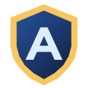

# Aegis



Aegis is a local-first workspace for managing autonomous software development. Its name comes from the mythological shield and reflects the role of sandboxing, independent review, and operator oversight.

- **Workspace** is the default environment for your OS user. It holds model settings, Skills, tools, and projects.
- **Project** groups a codebase, an optional GitHub repository, a model budget, and session history.
- **Session** tracks one request through Planning, Research, Architecture, Design, Development, Testing, and Release.

Open **Workflow** to inspect agents, handoffs, and approvals, and use **Lead Chat** to ask about an active session. **Session Summary** records the brief and decisions. **Release** holds the approved source archive, security review, and sandbox preview.

## Demo

Fieldwork is the bundled alpine expedition planner. Organize tasks across the board, explore the itinerary, and track gear and field notes. The preview stores edits in the browser for its own origin.


## Start

Install Python 3.12+, Git, Make, Node.js for JavaScript checks, and a running local Docker Engine or Docker Desktop. Clone Aegis and run these commands from the checkout.

```sh
git clone https://github.com/vidsattri-oss/Aegis.git
cd Aegis
make all
make test
make doctor
make run
```

For development, install `requirements-dev.txt` into a Python environment and run `make coverage`. It runs the tests and requires at least 85% line coverage across the Python application, CLI, and container code. Run `make smoke` to verify execution with real Docker containers.

Open [Workspace](http://127.0.0.1:8765/), create a Project, and select **Start demo** to build Fieldwork, an alpine expedition planner. When the session clears all checks, select **Release → Launch preview** to open Fieldwork in a separate tab. The demo uses bundled model responses and example research. It needs the local Docker images.

Use **Model Provider** to connect Microsoft Foundry or another service with a Chat Completions-compatible endpoint. For Foundry project discovery, paste the project endpoint from the portal with its API key or a current Microsoft Entra access token. Aegis adds `/openai/v1` when needed. A resource-only endpoint uses a resource key and a deployment name. Compatible local servers can use a loopback HTTP URL. Other providers use HTTPS. The Lead sends the relevant prompt, source and handoffs to the selected provider.

```sh
export AEGIS_PROVIDER=foundry
export AEGIS_ENDPOINT=https://YOUR-RESOURCE.services.ai.azure.com/api/projects/YOUR-PROJECT
# Supply AEGIS_API_KEY using your shell's secret management.
./dist/aegis serve --data .aegis-data --port 8765
```

`make build` produces `dist/aegis` and `dist/aegis-src.tar.gz`. Run the zip application with `python3 dist/aegis`. The source archive contains everything needed to rebuild its three Docker images. The first image build downloads base layers and Playwright dependencies. `make smoke` runs the demo against real containers, verifies all seven approvals including the Lead plan, fetches the preview, and checks the ZIP.

When upgrading, run `make all` for the Aegis executable and Docker images. Aegis can open your existing workspace directory with its projects, sessions, Git history, and provider settings. For an existing checkout or per-user installation, Aegis detects older workspace locations. Set `AEGIS_DATA` to the absolute path of your workspace to select it explicitly from any directory. Older environment settings and backups are supported.

## Start a GitHub-backed Project

In **New Project**, enter a GitHub HTTPS repository URL and, optionally, its source branch. Aegis imports the current commit of that branch. When the branch is blank, it uses the repository default. For a private repository or branch publishing, sign in with `gh auth login` on the machine running Workspace. The account needs read access to import and write access to publish.

```sh
aegis new-project "Task board" --github https://github.com/owner/repo --branch main
aegis run --project "Task board" "Add keyboard shortcuts for the existing board."
aegis publish SESSION_ID
```

The Lead, specialists, and reviewers receive the pinned commit, its editable paths, and relevant source excerpts. Development returns edits and explicit removals. The sandbox validates a bounded UTF-8 source tree using the existing static, Python, or Node runtime contract. Files outside that editable tree, such as binary blobs and dotfiles, remain in Git. The app must build and pass its tests using the editable source tree.

After approval, Aegis creates a local commit descended from the imported Git history. Later sessions start from the most recent approved commit in that Project. **Push session branch to GitHub** in Release publishes to `aegis/session-SESSION_ID`. Use GitHub's normal review and merge flow to update the source branch.

## Set a Project model budget

Open a Project and select **Model budget**. The USD limit covers model requests across its Sessions, including specialists, reviewers, retries, and Lead Chat. Enter zero to stop new model requests or leave the field blank to clear the limit. The Project shows recorded spend, remaining budget, and calls without complete pricing data. Docker compute estimates are shown separately.

Aegis records OpenRouter’s per-request credit charges and Claude Code’s reported USD estimates. With Microsoft Foundry, Azure AI Gateway, and other compatible APIs that return token counts, set the input and output prices in **Model Provider** to turn those counts into estimates. Azure billing records arrive later. The Copilot CLI integration lacks per-call USD data. Choose a provider with usable cost or token data for a budgeted Project. [OpenRouter usage](https://learn.openrouter.ai/courses/first-request/read-the-response) · [Claude Code estimates](https://code.claude.com/docs/en/headless#pipe-data-through-claude) · [Microsoft Foundry costs](https://learn.microsoft.com/en-us/azure/foundry/concepts/manage-costs)

For Microsoft Foundry or Azure AI Gateway, open **Azure model rates** on the Project to import published rates for each deployed model. Enter its Azure region and the matching input and output token meter IDs. Aegis fetches the meters from Microsoft and uses the saved rate for that deployment on new or resumed Sessions. Assign priced deployments to the agent roles when budgeting a pool of models. Retail rates are estimates before account discounts and other invoice adjustments. Aegis also pauses when Foundry rejects a call at a vendor cost control. [Azure Retail Prices API](https://learn.microsoft.com/en-us/rest/api/cost-management/retail-prices/azure-retail-prices) · [Foundry cost controls](https://learn.microsoft.com/en-us/azure/foundry/concepts/cost-controls)

Aegis allows one model request at a time per budgeted Project. It also passes the remaining amount to Claude Code’s own budget control. When recorded spend reaches the limit, the next request is blocked. An in-flight request can still push the total past the limit. If a call has no usable cost or its charge is missing after restart, Aegis pauses paid work for the Project. Review the provider’s usage and save the budget before resuming. **Resume session** continues from the most recent approved stage after the budget permits it. [Claude Code budget flag](https://code.claude.com/docs/en/cli-reference)

```sh
aegis budget --project "Task board" --limit 20
aegis budget --project "Task board" --json
aegis budget --project "Task board" --clear
```

## Install the CLI

From the repository root, install the command for your user account.

```sh
make install
```

This installs the executable at `~/.local/bin/aegis`. If your shell can't find it, add `export PATH="$HOME/.local/bin:$PATH"` to your shell startup file and run that line in the current terminal. Use `make install PREFIX=/path/to/prefix` to choose another prefix. Rerun `make install` to update the executable.

## Run from the terminal

Open a regular terminal in any directory and run `aegis` or `aegis chat` to see the animated blue-and-gold ASCII shield. From the checkout, you can also run `python3 -m aegis chat` or use `make build` and `./dist/aegis chat`.

A fresh installation defaults to one workspace per OS user at `$XDG_DATA_HOME/aegis` or `~/.local/share/aegis`. Running the CLI from a different directory opens the same workspace. Use `--data PATH` to select an explicit directory for a command or a restore.

Type a brief to start a session, then use Lead Chat to ask the lead agent about progress or results. Use `/project` to switch Projects, `/sessions` to list recent sessions, `/watch` to follow one, and `/help` for the full command list. Try `/demo` for the offline Fieldwork demo. Type `exit` or `/exit` to leave Aegis and return to your shell.

Run `/setup` in the terminal to choose a provider. Aegis tests the selected connection before saving it. Use `/provider` to see the selection and `/provider test` to check it again.

- **Claude Code.** Install `claude` on the workspace host and sign in with `claude auth login`. Setup reuses the CLI sign-in and lets you use its default model or choose a model ID. [Claude Code authentication](https://code.claude.com/docs/en/authentication)
- **GitHub Copilot CLI.** Install `copilot` on the workspace host, open it, and enter `/login`. Setup can also use `COPILOT_GITHUB_TOKEN` from the workspace process. [GitHub Copilot CLI authentication](https://docs.github.com/en/copilot/how-tos/copilot-cli/set-up-copilot-cli/install-copilot-cli#authenticating-with-copilot-cli)
- **Microsoft Foundry.** Copy the endpoint and key from the project’s **Home** page. Setup discovers chat deployments from a project endpoint or asks for a deployment name when you enter a resource endpoint.
- **Local model.** Start an OpenAI-compatible server on the workspace host. Setup defaults to Ollama at `http://127.0.0.1:11434/v1` and can list installed model IDs. [Ollama’s OpenAI compatibility](https://docs.ollama.com/api/openai-compatibility)

Claude Code and Copilot run in prompt mode with agent tools restricted. Aegis still runs the existing validations, Docker builds, and browser tests. Each CLI authenticates on the machine running the workspace, which also applies when you open the dashboard in a browser.

```sh
./dist/aegis chat --project "Task board"
./dist/aegis chat --session SESSION_ID --no-animation
```

If Workspace is running, the terminal shares its Projects, sessions, and Lead Chat messages. When running on its own, the terminal hosts the Lead until you exit. Reopen the terminal to resume interrupted work. The CLI adapts its colors to the terminal. Use `NO_COLOR=1` for monochrome or `--no-animation` for a static display. `make run` and `serve` open the dashboard.

`make all` builds the executable and the required Docker images. Run a complete demo without opening the dashboard.

```sh
./dist/aegis doctor
./dist/aegis doctor --full --local-only
./dist/aegis run --demo
```

Full preflight checks Docker, all three role images, and whether a container can read a workspace bind mount and any configured offline cache directories. Use `doctor --full` to also send a small request to the configured model provider. In the dashboard, open **Execution → Local preflight**. The model request is optional there. Builds still check whether the cache contains each dependency they need.

For a custom request, configure the provider in the dashboard or set `AEGIS_PROVIDER`, `AEGIS_ENDPOINT`, `AEGIS_MODEL`, and any needed `AEGIS_API_KEY` in your shell. The CLI accepts a Project name or ID. It creates the named Project if it does not exist. Pass a quoted request, use `--prompt-file request.md`, or read a request from stdin with `--prompt-file -`.

```sh
./dist/aegis run --project "Task board" "Add keyboard shortcuts to create and complete tasks."
./dist/aegis sessions --project "Task board"
./dist/aegis logs SESSION_ID --stage qa --follow
./dist/aegis status SESSION_ID --json
./dist/aegis retry SESSION_ID
./dist/aegis cancel SESSION_ID
./dist/aegis preview SESSION_ID
```

The CLI uses the running dashboard for the same workspace when available. Use `--connect PORT` to choose a specific loopback dashboard, or `--data PATH` to use a separate workspace. For a standalone run, the CLI hosts the Lead until the run completes and preserves the build ZIP. Run `preview` to keep the completed application available while the command is running. When connected to a dashboard, use `run --detach` or `retry --detach` to queue a run and return its ID. Use `serve` to open the dashboard on demand, or `--help` to list the CLI commands. Failed runs return a nonzero exit status.

## Model discovery and local credentials

In **Model Provider**, choose **Microsoft Foundry**, paste the project endpoint and credential from the project’s **Home** page, then save. Aegis imports the project’s deployments for the workspace. Use **Load deployments** to preview the list and optionally assign a model to an agent role. Automatic routing spreads roles across chat deployments and keeps assignments stable within each session. Sessions keep their model pool when you refresh the workspace list by saving settings again. Each model call logs its deployment name. For a resource-only endpoint, enter the deployment name directly. Gateways and compatible servers can use **Load models** when they expose a `/models` route. [Foundry project deployments API](https://learn.microsoft.com/en-us/rest/api/microsoft-foundry/aiproject#deployments---list)

**Remember in the system keyring** saves the provider credential in the Linux desktop Secret Service, such as GNOME Keyring or KWallet with Secret Service enabled. Aegis keeps only a reference in its workspace database. A saved credential is scoped to the workspace and provider endpoint and is shared by the dashboard and CLI. Leaving **Remember** unchecked keeps a newly entered credential in the dashboard process. Use **Forget saved credential** and save settings to remove the keyring entry. Entra access tokens still expire and must be refreshed. On Debian and Ubuntu, the runtime bindings are provided by `python3-gi` and `gir1.2-secret-1`. The desktop keyring must be reachable from the process.

```sh
./dist/aegis models --json
./dist/aegis credential save
./dist/aegis credential forget
```

For a Foundry project, `models` prints deployment names. `credential save` prompts with input hidden. Use `credential save --from-env` to save an already loaded `AEGIS_API_KEY` or `AI_GATEWAY_API_KEY`. Set `AEGIS_PROVIDER=foundry` and `AEGIS_ENDPOINT` to the project URL to discover and route across deployments from the CLI. Set `AEGIS_MODEL` only to pin a specific deployment or use a resource-only endpoint.

## Microsoft Foundry through Azure AI Gateway

Use the Azure AI Gateway resource described in Microsoft's overview. Import a chat-capable Foundry model into the gateway, then copy its full Chat Completions endpoint and callable alias from the gateway portal. Use an Azure AI Gateway runtime key. The Lead sends it as a bearer credential and the gateway handles authentication to Foundry. [Azure AI Gateway overview](https://learn.microsoft.com/en-us/azure/ai-gateway/overview) · [Microsoft quickstart](https://learn.microsoft.com/en-us/azure/ai-gateway/quickstart-create-ai-gateway)

In the dashboard, select **Azure AI Gateway for Foundry** under Provider settings, then enter the endpoint, alias, and runtime key. **Test saved provider** sends a fixed connectivity message. From a terminal, use the copied values and load the runtime key into `AI_GATEWAY_API_KEY` through your shell's secret management or save it in the system keyring.

```sh
export AEGIS_PROVIDER=azure-gateway
export AI_GATEWAY_CHAT_URL='https://YOUR-GATEWAY-HOST/default/models/openai/v1/chat/completions'
export AI_GATEWAY_MODEL='YOUR-CALLABLE-ALIAS'
./dist/aegis provider-test
./dist/aegis run --project "Task board" "Build a task board with accessible keyboard navigation."
```

The gateway endpoint may also be supplied as `AEGIS_ENDPOINT`, the alias as `AEGIS_MODEL`, and the runtime key as `AEGIS_API_KEY`. The Lead redacts known credentials from telemetry.

## MCP and Skills

Select the extensions each role can use in `extensions.toml` inside your workspace data directory. The dashboard **Skills & Tools** view and `extensions --check` list configured scopes and verify MCP discovery. The Lead reads extension configuration when a new session starts. The bundled demo continues to use its fixed offline inputs.

Use **Skills & Tools → Edit configuration** to update the workspace TOML. The editor shows the exact OAuth callback URL for this dashboard. For a public HTTPS MCP server, add `oauth = {}` to use dynamic client registration, or use `oauth = { client_id = "your-public-client-id", scopes = ["your-scope"] }` with a registered public client. Save, then choose **Connect in browser** for the server. Sign-in uses PKCE with an exact loopback callback and stays in the running dashboard. Environment-backed MCP credentials remain available.

Use **Skills & Tools → Add Skill** to upload `SKILL.md` with up to eight UTF-8 references. The folder picker preserves relative paths. Select each file to edit its text, choose the agent roles, and save. Use **Edit files** to revise it later. Browser edits apply to new sessions and live in `browser-skills.json` alongside `extensions.toml`.

For a first workspace configuration, copy the shipped example and its Skill into the data directory.

```sh
workspace_dir=/path/to/your/workspace
cp -R examples/skills "$workspace_dir/"
cp -n examples/extensions.toml "$workspace_dir/extensions.toml"
./dist/aegis extensions --check --data "$workspace_dir"
```

The example grants Research read-only access to Microsoft Learn and Cloudflare documentation. The optional Cloudflare account connection uses browser OAuth and grants the Lead the read-only identity tool. The lean-code Skill supports Architecture, Development, and Review. Studio UI/UX supports Design, Development, QA, and Review. Set `AEGIS_EXTENSIONS` to select a configuration file. Skill and stdio working-directory paths resolve relative to that file. [Microsoft Learn MCP](https://learn.microsoft.com/en-us/training/support/mcp-developer-reference) · [Cloudflare MCP servers](https://developers.cloudflare.com/agents/model-context-protocol/cloudflare/servers-for-cloudflare/)

- **MCP** accepts Streamable HTTP and stdio servers. Local stdio defaults to a resource-limited Docker sandbox with no network or inherited credentials and a read-only mount of the server's bundle. Put the bundled code and dependencies under `mcp/<server>` next to `extensions.toml`, give UID 10001 read access, and use `python`, `python3`, or `node` as the command. An existing host executable requires explicit `isolation = "host"` and runs with the workspace user's permissions. Use this setting only for software you trust. A tool must be granted to the role in TOML and advertise `readOnlyHint: true`. The Lead validates arguments, bounds and redacts tool output, and logs each call. MCP results enter the model as untrusted evidence.
- **Gateway-published MCP** uses the copied MCP endpoint of your federated Azure AI Gateway tool server as its `url`. Set `token_env` to the environment variable containing its bearer credential. For endpoints using key-based headers, set `api_key_env` and optionally `key_header` to `api-key`, `x-api-key`, or `Ocp-Apim-Subscription-Key`. Model and MCP endpoints are configured independently. [Azure AI Gateway concepts](https://learn.microsoft.com/en-us/azure/ai-gateway/concepts)
- **Skills** load trusted `SKILL.md` guidance and explicitly selected text resources for the named roles. Resources must reside within the selected Skill directory. A Skill's instructions can use the role's existing tools. Script execution and additional permissions come from the harness, independently of the Skill. [Agent Skills format](https://agentskills.io/specification)

## Role container tools

The Lead calls the configured model and brokers approved network access. In each role container, an offline tool accepts bounded JSON over a pipe, checks its arguments, and returns structured evidence. The Lead records tool calls and results with the attempt. Roles have an allowlist of operations for their assignment.

| Role | Container tools and output |
| --- | --- |
| Lead | Builds the station assignment and acceptance criterion matrix. |
| Research | Indexes citations from the Lead’s verified public sources. |
| Architecture | Checks the proposed runtime and deployment mode against the runtime matrix. |
| UX/UI design | Renders escaped, standalone HTML from the draft wireframes and records accessibility requirements. |
| Development | Uses Python AST parsing and Node syntax checks on draft code, then reports imports, file sizes, checksums, and identical files. |
| QA/UAT | Produces an acceptance-criteria coverage matrix. The QA runner executes language tests and Chromium journeys. |
| Release | Produces a checksum manifest for the verified source. The runtime rebuilds it and hosts the loopback preview. |
| Independent QA | Checks that the required execution evidence is present before the reviewer model sees the deliverable. |

### Docker permissions and images

Aegis uses one Docker engine and builds three reusable images from `containers/Dockerfile`. Worker provides Python role tools, runtime provides Python and Node for source checks, application builds, and previews, and QA adds Chromium and Playwright for browser testing. The Lead uses the Docker context available to the user running Aegis. Each agent container runs as UID 10001 with a read-only root, isolated networking, dropped capabilities, and bounded mounts. The Lead handles upstream model and approved tool traffic. [Docker Engine security](https://docs.docker.com/engine/security/)

### Container sizes and parallel work

Open **Execution** to see the effective limits. Aegis scales each task’s CPU and RAM using the active Docker engine’s allocation, with task-specific minimums and a ceiling of twice the reference size. Process caps stay proportional to the task’s tools. Check a task’s sizing box to pin individual limits. These are local Docker limits. The selected provider controls inference compute. [Docker resource constraints](https://docs.docker.com/engine/containers/resource_constraints/) · [Docker Desktop allocation settings](https://docs.docker.com/desktop/settings-and-maintenance/settings/#vm-resources)

The table shows reference sizes for an engine with 8 CPU cores and 4 GiB of RAM.

| Task | CPU cores | Memory (MiB) | Process cap |
| --- | ---: | ---: | ---: |
| Lead, Research, Architecture, Design, QA planning, Release planning, Independent Review | 0.5 | 128 | 48 |
| Sandboxed MCP server | 0.5 | 256 | 64 |
| Development source checks | 1 | 256 | 64 |
| Application build, artifact QA, release build, preview | 1 | 512 | 128 |
| Browser QA | 2 | 1,536 | 256 |

Up to three sessions from different projects can run by default. The workspace setting supports one to eight. Work in the same project queues behind its current session to preserve the approved source history. Enable **Run two independent reviewers per gate** to check acceptance criteria and execution evidence concurrently. Both reviewers must approve before advancement. Resource limits and review settings apply when a session starts or retries.

Enable **Adapt concurrent sessions to Docker capacity** to use the configured session count as a ceiling. The scheduler estimates how many sessions can fit their heaviest stage, accounting for live previews and other containers. It adds at most one slot per sample and reduces admission as soon as pressure rises. Missing or stale Docker measurements limit admission to one session. Each stage still reserves its actual resources before launching. The corresponding CLI setting is `adaptive_sessions`.

**Maximum simultaneous model requests** (`model_slots`) limits model calls across running Sessions and Lead Chat. It defaults to three and is configurable from one to eight. Set it to fit your model provider’s capacity independently of Docker settings.

During planning the Lead can choose a compact sandbox for specialists, builds, and QA. Compact lowers CPU and RAM where Execution has no manual override. A retry can use the standard profile within the same workspace limits. The Lead can include role-specific guidance in a handoff. Agents controls the images, mounts, network, credentials, process limits, and approvals. The chosen profiles and execution evidence appear in Telemetry.

Aegis reads the Docker engine’s allocation again when a session starts or retries. The logs record which sizes the session received. The workspace keeps up to 512 MiB for the engine and queues work against the remaining budget. Its reservations include live previews and overlapping role, build, browser QA, and MCP containers. It also samples CPU and memory used by other containers on the same engine, including other workspaces. **Execution → Live Docker pressure** shows the sample and the sessions holding reservations here. Docker usage samples estimate shared load at a point in time. A task that cannot fit by itself reports the resource shortfall. [Docker stats](https://docs.docker.com/reference/cli/docker/container/stats/)

```sh
./dist/aegis execution --json > execution.json
./dist/aegis execution --pressure
# Edit overrides to set fixed values, then apply the settings.
./dist/aegis execution --apply execution.json
```

The `limits` and `capacity` fields report the detected configuration. Edit `overrides` to pin individual values. To restore a field’s automatic size, remove its override. Older saved limits that matched the previous defaults migrate to automatic sizing. Values that differed carry forward as overrides.

## Run as a Linux user service

Stop the foreground dashboard before starting the service for the same workspace. Use `--docker-context` for a specific engine, such as `desktop-linux` for Docker Desktop on Linux. The unit uses the user's Docker access and restarts the Lead after a process failure. `--data` and `--port` select the workspace and dashboard port. [systemd service units](https://www.freedesktop.org/software/systemd/man/latest/systemd.service.html)

```sh
mkdir -p ~/.config/systemd/user
./dist/aegis service --docker-context desktop-linux --write ~/.config/systemd/user/aegis.service
systemctl --user daemon-reload
systemctl --user enable --now aegis.service
journalctl --user -u aegis.service -f
```

Use `~/.config/aegis/service.env` for optional settings such as `AEGIS_WHEELHOUSE` and `AEGIS_NPM_CACHE`. Use absolute paths and keep provider credentials in the desktop keyring. The keyring needs an unlocked user session.

## Back up and recover

Stop the dashboard or user service so the workspace cannot change during backup. Use a new archive path in an existing directory. The private ZIP contains a consistent SQLite snapshot, all managed Git refs, and saved build archives. It excludes credential files, keyring secrets, local extensions and Skills, and runtime caches. Copy trusted local extension configuration and Skills separately if you need them on a restored workspace. [SQLite backup API](https://www.sqlite.org/backup.html)

```sh
./dist/aegis backup --data .aegis-data workspace-backup.zip
./dist/aegis restore workspace-backup.zip --data .aegis-restored
./dist/aegis serve --data .aegis-restored --port 8766
```

Restore verifies and opens into a new directory with a new workspace identity. Reload your provider credential when you open the restored workspace. Start any needed previews from their completed sessions.

## Development lifecycle

1. **Planning.** The Lead defines the assignments and observable acceptance criteria. An independent reviewer checks the plan.
2. **Research.** The researcher iterates over evidence requests, checks official documentation on allowlisted hosts, and can query OSV for proposed package versions. The next stage starts only when an independent reviewer approves the research.
3. **Architecture.** The architect defines interfaces, runtime, and boundaries, with independent review.
4. **Design.** The designer maps user flows and accessibility requirements for review.
5. **Development.** The developers produce the complete source tree. The Lead checks the path and runtime contract, scans locked dependency versions against OSV, builds in Docker, and routes source and evidence for review.
6. **Testing.** QA associates each acceptance criterion with a check, runs applicable language tests, and runs Playwright Chromium journeys for web deliverables. Independent review decides the gate.
7. **Release.** The Lead rebuilds the tested source and reviews the verification handoff. The Lead packages the source into a ZIP, checks the isolated web preview if applicable, and atomically merges the session branch into `main`.

The Lead records every attempt with its persona, input, resource allocation, tool events, log output, and exceptions. Gate failures produce audit commits, include the failure context in a replacement attempt, and stop the session after three failures. A failed or cancelled session can resume at its first unapproved stage. On restart, the Lead recovers approvals from Git, marks interrupted attempts, and removes leftover workspace containers when Docker is available. One session at a time changes a project branch. Sessions for different projects can progress concurrently.

Workspace shows local Projects, model and compute estimates, agent counts, and build health. Each session has a floating Lead Chat panel and three views. Workflow shows the reporting hierarchy, workflow, and telemetry. Session Summary records the plan and decisions. Release holds the approved build and preview. Select a role, stage, or attempt count to filter telemetry, then open an individual attempt to inspect its persona, input, resource profile, and trace. Changes to requirements start a follow-up session with its own approvals.

Open **Lead Chat** on a running Session to ask the lead agent about progress. A question gets priority for the next available model slot within the Project budget. If a slot stays busy, the Lead returns the current status from Telemetry. To send implementation guidance, select **Session note** in the same panel. Agents see up to three recent notes at the next handoff or retry. Approved criteria and access controls still apply.

## Specialists and agent playbooks

The Lead can delegate up to two distinct advisory tasks. Each brief names the stage that needs the result, one acceptance criterion, a concrete deliverable, and up to three source paths. The Lead dispatches the specialists once that stage’s prerequisites are approved. Specialists on the same stage can run concurrently, subject to Docker capacity, provider slots, and the Project budget. When multiple eligible deployments are available, automatic routing spreads specialists and parallel reviewers across them. Explicit role model assignments take precedence. An unpriced optional advisor is skipped before it can send a request for a budgeted Project.

Specialists receive the brief, scoped excerpts, approved summaries, and relevant workspace Skills. They run in networkless sandboxes with read-only advisory tools. Specialist Skills can shape the report and cannot grant additional tools or credentials. Source citations must match the supplied excerpts. The controller stamps the stage, criterion, and attempt on the report, and delivers it as advisory evidence to that stage’s author and reviewers. Reviewers also receive the stage’s Skills to check the deliverable against them. **Telemetry** shows assignments, reports, and skipped specialists. An unavailable advisor leaves other reports usable. An author retry reuses the same reports if the operator notes are unchanged. [OWASP inter-agent communication guidance](https://genai.owasp.org/agentic-applications-2026/asi07-insecure-inter-agent-communication/)

When Architecture can identify independent implementation tasks, it proposes two or three **Development Team** workstreams with exact file ownership and a shared interface. The Lead dispatches them after Architecture and Design are approved. Each worker receives the same pinned base, the relevant source files, and the workspace’s Development Skills. Workers return patches from separate networkless sandboxes. The Lead validates edits and deletions against each assignment, assembles one candidate, then runs the usual build, independent review, QA, and release checks. A resumed Session can reuse validated patches for the same inputs. Coupled changes and failed integrations use one development author. **Telemetry** shows the assignments, validated patches, and integration outcome.

Each role receives its own Project playbook. An agent can propose a technique for future sessions and cite evidence from validation. Aegis records lessons after the gate passes, including successful recoveries after failed attempts. **Memory → Consolidate notes** groups recent verified lessons into versioned playbooks between sessions. Later attempts receive those playbooks as evidence while the user’s brief and the approval checks continue to define success. This applies Anthropic’s evaluate-and-iterate pattern to agent guidance. [When AI builds itself](https://www.anthropic.com/institute/recursive-self-improvement)

**Deep Research** in Execution (`deep_research` in the CLI settings) uses the approved acceptance criteria to guide up to six evidence rounds per attempt. Aegis retains support backed by exact excerpts from fetched official sources, targets gaps in subsequent rounds, and records progress in Telemetry. The research handoff names the remaining gaps for independent review. The loop stops when coverage is complete, when two rounds add no evidence after a source is verified, or when it reaches the existing stage deadline or round limit. [Autoresearch program](https://github.com/karpathy/autoresearch/blob/master/program.md)

If an application fails its sandbox QA checks after passing the build gate, the Lead gives Development one repair round with the failing candidate and diagnostics. It checkpoints the request in Git, has the amended build independently reviewed, and reruns the same QA plan before release. Transport errors and timeouts follow the normal stage retry path.

## Runtime and data

- **Deliverables** use a `harness.json` with `runtime` set to `static`, `python`, or `node` and `mode` set to `web` or `artifact`. Python and Node also specify a source `entry` and runnable unit tests. Web apps serve on `HOST=127.0.0.1` and `PORT=8080` inside the runtime. Artifact entry points run without arguments during build verification. Source is text, with a 120-file and 1.25 MB limit. App code runs directly in Chromium, Python, or Node without arbitrary build scripts.
- **Dependencies** default to the runtimes’ standard libraries. Python can use exact pins for all dependencies in `requirements.txt` and a trusted offline wheel directory set through `AEGIS_WHEELHOUSE`. Node can use an npm v2/v3 lockfile with integrity fields and an offline cache set through `AEGIS_NPM_CACHE`. Installers run offline and npm lifecycle scripts are disabled. The Lead checks known OSV advisories before executing builds.
- **Sandboxes** use separate role, QA, and runtime resource profiles, a non-root user, no Linux capabilities, read-only root filesystems, bounded scratch filesystems, and no direct network. The Lead brokers configured model traffic, public HTTPS research on exact approved hostnames, and OSV checks. `AEGIS_RESEARCH_HOSTS` adds comma-separated official hosts. The Lead filters suspicious instructions and redacts common credentials and configured provider keys from persisted telemetry.
- **Previews** run in a separate container with loopback networking only. The host relay forwards ordinary HTTP requests to that container’s app. Agents communicate through Lead-managed handoffs and tools. Build and browser QA each start their own copy of the app inside their own container. The preview relay accepts a limited set of request and response headers and blocks service worker registration. Workspace restricts browser API access to its own origin. Start or stop previews from Release. Preview URLs change on restart. The default preview lifetime is one hour and can be changed with `AEGIS_PREVIEW_SECONDS`. [Docker network isolation](https://docs.docker.com/engine/network/drivers/none/)
- **Release security review** examines the final source and sandbox evidence before release. The Lead reruns OSV for pinned application dependencies and fetches current Docker and OWASP guidance when available. An independent reviewer records checks and remaining risks in **Release → Security review**. Known dependency advisories and rejected reviews block release. The report covers the generated deliverable and its pinned dependencies. Host Docker and base-image patching are operator responsibilities. [OWASP Top 10 for Agentic Applications](https://genai.owasp.org/top-10-for-agentic-applications-2026/) · [Docker Engine security](https://docs.docker.com/engine/security/) · [OSV](https://osv.dev/)
- **Git** lives under `monorepo` in the workspace data directory. Source lives at `projects/<project-id>/app`. Session documents and audit logs live at `.omni/sessions/<session-id>`. Session worktrees, packages and staging inputs share the same private data directory.
- **Memory** stores nodes and edges in the SQLite workspace database. Approved decisions, verified patterns, failures and remedies persist across projects. Relevance increases when an approved artifact demonstrates use of a retrieved node. Memory consolidation deduplicates canonical records, prunes old unlinked low-weight nodes, and connects recurring fixes and cross-project practices. Set `AEGIS_DREAM_INTERVAL` to tune its interval or use the workspace button during idle time.
  Open the **Memory** to consolidate session notes, view earlier consolidation runs, or search recorded decisions and links.
- **Costs** use vendor charges or estimates when available, and provider-reported token counts priced at configured rates otherwise. Docker compute estimates use CPU allocation time.
- **Timeouts** are bounded per stage attempt with `AEGIS_STAGE_TIMEOUT`, defaulting to 240 seconds. Model calls, source retrieval, browser actions, execution logs, process counts and preview requests also have narrower limits.

The workspace directory is per OS user. Store it on local storage accessible to the local Docker daemon. This implementation supports a single workspace owner on loopback. The preview is a local release environment.
