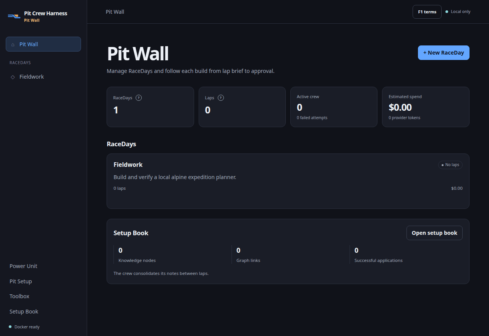
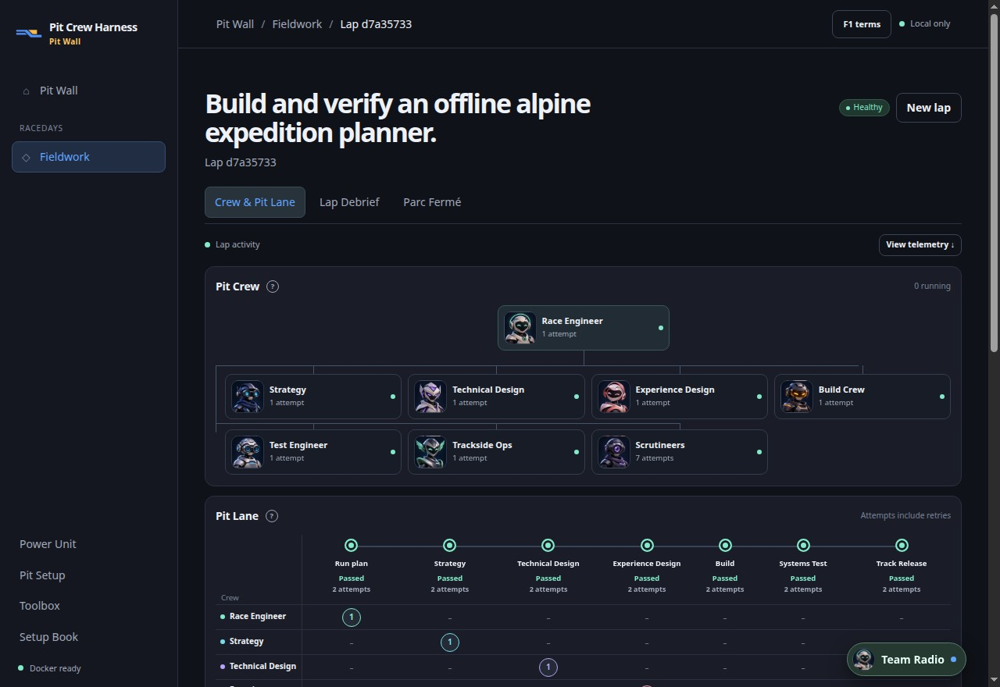
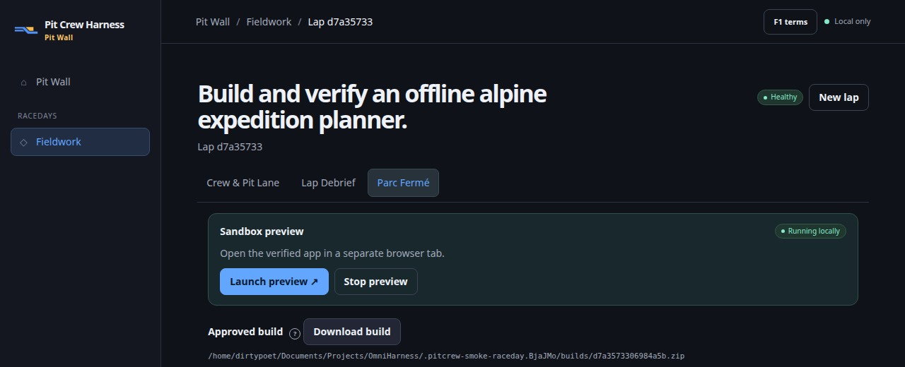
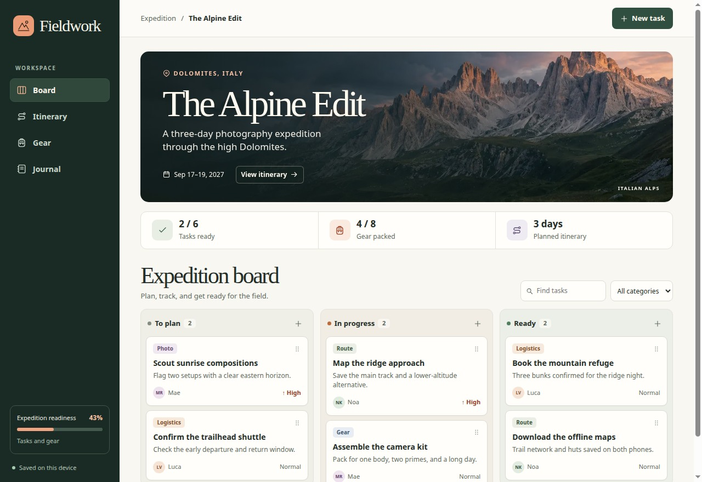

# Pit Crew Harness


**An agent says the build is done. What passed, and where can you try it?**

Pit Crew Harness turns a software request into a reviewed, runnable build whose decisions and test results you can inspect. It's a single-user, local-first workspace you can drive from the Pit Wall dashboard or the interactive `pitcrew` CLI.

The race engineer defines acceptance criteria and coordinates six stages from strategy through track release. Independent scrutineers review each stage, Docker builds and tests the deliverable, and Pit Wall keeps crew attempts, telemetry, and approvals together. Once the checks pass, open Parc Fermé to download the source ZIP or try the build in its sandbox preview. [Try the practice run](#start)

## Where it helps

- **Prototype a web app or internal tool.** Give the race engineer a brief, try the result in a local preview, and start another lap when you discover what needs to change.
- **Review agent-generated work.** See which checks ran, why a stage passed or failed, and which Git commit contains the approved work.
- **Reuse a workflow across RaceDays.** Give the crew the Skills and read-only MCP tools they need, then use the Setup Book to find and consolidate decisions and verified patterns from earlier laps.

## In action

The walkthrough follows a Fieldwork practice lap from Pit Wall through the Pit Lane, Lap Debrief, and Parc Fermé. [Open the walkthrough GIF](docs/screenshots/pitcrew-walkthrough.gif)



## Why Pit Crew Harness?

A Formula 1 pit crew works from a shared plan, with each specialist responsible for part of the job. Pit Crew Harness uses the same idea for software delivery. **Pit Wall** is your workspace. It contains **RaceDays** (projects), and each RaceDay contains **laps** (build sessions). **Pit Lane** shows how work passes between specialists during a lap. Reach the race engineer through **Team Radio**, check events in **Telemetry**, and open approved builds in **Parc Fermé**. [Formula 1 glossary](https://www.formula1.com/en/latest/article/f1-glossary-p-t.GBhLQtpeu9b8LrK5VM0F1)

## Screenshots

### Crew & Pit Lane



### Parc Fermé



### Fieldwork demo

Fieldwork is the bundled alpine expedition planner. Organize tasks across the board, explore the three-day itinerary, track packed gear, and record field notes. The preview stores edits in the browser for its own origin.



## Start

Install Python 3.12+, Git, Make, Node.js for JavaScript checks, and a running local Docker Engine or Docker Desktop. Run these commands from the checkout.

```sh
make all
make test
make doctor
make run
```

Open [Pit Wall](http://127.0.0.1:8765/), create a RaceDay, and select **Start practice run** to build Fieldwork, an alpine expedition planner. When the lap clears all checks, select **Parc Fermé → Launch preview** to open Fieldwork in a separate tab. The practice run uses bundled model responses and example research. It needs the local Docker images.

Hover or Tab to an F1 term for its definition. On a touchscreen, tap a **?** icon. Open **F1 terms** in the top bar for the full glossary.

Use **Power Unit** to connect Microsoft Foundry or another service with a Chat Completions-compatible endpoint. For Foundry project discovery, paste the project endpoint from the portal with its API key or a current Microsoft Entra access token. Pit Crew Harness adds `/openai/v1` when needed. A resource-only endpoint uses a resource key and a deployment name. Compatible local servers can use a loopback HTTP URL. Other providers use HTTPS. The Lead sends the relevant prompt, source and handoffs to the selected provider.

```sh
export PITCREW_PROVIDER=foundry
export PITCREW_ENDPOINT=https://YOUR-RESOURCE.services.ai.azure.com/api/projects/YOUR-PROJECT
# Supply PITCREW_API_KEY using your shell's secret management.
./dist/pitcrew serve --data .pitcrew-data --port 8765
```

`make build` produces `dist/pitcrew` and `dist/pitcrew-src.tar.gz`. Run the zip application with `python3 dist/pitcrew`. The source archive contains everything needed to rebuild its three Docker images. The first image build downloads base layers and Playwright dependencies. `make smoke` runs the demo against real containers, verifies all seven approvals including the Lead plan, fetches the preview, and checks the ZIP.

When upgrading an existing checkout, run `make all` to build the new executable and image tags. With no explicit data path, Pit Crew Harness opens an existing `.omni-data` directory if `.pitcrew-data` is absent. It also accepts `OMNI_` environment settings and existing workspace backups.

## Start a GitHub-backed RaceDay

In **New RaceDay**, enter a GitHub HTTPS repository URL and, optionally, its source branch. Pit Crew imports the current commit of that branch. When the branch is blank, it uses the repository default. For a private repository or branch publishing, sign in with `gh auth login` on the machine running Pit Wall. The account needs read access to import and write access to publish.

```sh
pitcrew new-raceday "Task board" --github https://github.com/owner/repo --branch main
pitcrew run --raceday "Task board" "Add keyboard shortcuts for the existing board."
pitcrew publish LAP_ID
```

The Lead, specialists, and reviewers receive the pinned commit, its editable paths, and relevant source excerpts. Development returns edits and explicit removals. The sandbox validates a bounded UTF-8 source tree using the existing static, Python, or Node runtime contract. Files outside that editable tree, such as binary blobs and dotfiles, remain in Git. The app must build and pass its tests using the editable source tree.

After approval, Pit Crew creates a local commit descended from the imported Git history. Later laps start from the most recent approved commit in that RaceDay. **Push lap branch to GitHub** in Parc Fermé publishes to `pitcrew/lap-LAP_ID`. Use GitHub's normal review and merge flow to update the source branch.

## Install the CLI

From the repository root, install the command for your user account.

```sh
make install
```

This installs the executable at `~/.local/bin/pitcrew`. If your shell can't find it, add `export PATH="$HOME/.local/bin:$PATH"` to your shell startup file and run that line in the current terminal. Use `make install PREFIX=/path/to/prefix` to choose another prefix. Rerun `make install` to update the executable.

## Run from the terminal

Open a regular terminal in any directory and run `pitcrew` or `pitcrew chat` to see the animated blue-and-gold ASCII pit entry. From the checkout, you can also run `python3 -m pitcrew chat` or use `make build` and `./dist/pitcrew chat`.

Outside a checkout or a directory with an existing `.pitcrew-data` or `.omni-data` workspace, Pit Crew uses `$XDG_DATA_HOME/pitcrew` or `~/.local/share/pitcrew`. Set `PITCREW_DATA` to the absolute path of an existing workspace to use it from every directory. To use a different workspace for one command, pass `--data PATH`.

Type a brief to start a lap, then use Team Radio to ask the race engineer about progress or results. Use `/raceday` to switch RaceDays, `/laps` to list recent laps, `/watch` to follow one, and `/help` for the full command list. Try `/demo` for the offline Fieldwork practice run. Type `exit` or `/exit` to leave Pit Crew and return to your shell.

Run `/setup` in the terminal to choose a provider. Pit Crew Harness tests the selected connection before saving it. Use `/provider` to see the selection and `/provider test` to check it again.

- **Claude Code.** Install `claude` on the workspace host and sign in with `claude auth login`. Setup reuses the CLI sign-in and lets you use its default model or choose a model ID. [Claude Code authentication](https://code.claude.com/docs/en/authentication)
- **GitHub Copilot CLI.** Install `copilot` on the workspace host, open it, and enter `/login`. Setup can also use `COPILOT_GITHUB_TOKEN` from the workspace process. [GitHub Copilot CLI authentication](https://docs.github.com/en/copilot/how-tos/copilot-cli/set-up-copilot-cli/install-copilot-cli#authenticating-with-copilot-cli)
- **Microsoft Foundry.** Copy the endpoint and key from the project’s **Home** page. Setup discovers chat deployments from a project endpoint or asks for a deployment name when you enter a resource endpoint.
- **Local model.** Start an OpenAI-compatible server on the workspace host. Setup defaults to Ollama at `http://127.0.0.1:11434/v1` and can list installed model IDs. [Ollama’s OpenAI compatibility](https://docs.ollama.com/api/openai-compatibility)

Claude Code and Copilot run in prompt mode with agent tools restricted. Pit Crew Harness still runs the existing validations, Docker builds, and browser tests. Each CLI authenticates on the machine running the workspace, which also applies when you open the dashboard in a browser.

```sh
./dist/pitcrew chat --raceday "Task board"
./dist/pitcrew chat --lap LAP_ID --no-animation
```

If Pit Wall is running, the terminal shares its RaceDays, laps, and Team Radio messages. When running on its own, the terminal hosts the Lead until you exit. Reopen the terminal to resume interrupted work. The CLI adapts its colors to the terminal. Use `NO_COLOR=1` for monochrome or `--no-animation` for a static display. `make run` and `serve` open the dashboard.

`make all` builds the executable and the required Docker images. Run a complete demo without opening the dashboard.

```sh
./dist/pitcrew doctor
./dist/pitcrew doctor --full --local-only
./dist/pitcrew run --demo
```

Full preflight checks Docker, all three role images, and whether a container can read a workspace bind mount and any configured offline cache directories. Use `doctor --full` to also send a small request to the configured model provider. In the dashboard, open **Pit Setup → Local preflight**. The model request is optional there. Builds still check whether the cache contains each dependency they need.

For a custom request, configure the provider in the dashboard or set `PITCREW_PROVIDER`, `PITCREW_ENDPOINT`, `PITCREW_MODEL`, and any needed `PITCREW_API_KEY` in your shell. The CLI accepts a RaceDay name or ID. It creates the named RaceDay if it does not exist. Pass a quoted request, use `--prompt-file request.md`, or read a request from stdin with `--prompt-file -`.

```sh
./dist/pitcrew run --raceday "Task board" "Add keyboard shortcuts to create and complete tasks."
./dist/pitcrew laps --raceday "Task board"
./dist/pitcrew telemetry LAP_ID --stage qa --follow
./dist/pitcrew status LAP_ID --json
./dist/pitcrew retry LAP_ID
./dist/pitcrew cancel LAP_ID
./dist/pitcrew preview LAP_ID
```

The CLI uses the running dashboard for the same workspace when available. Use `--connect PORT` to choose a specific loopback dashboard, or `--data PATH` to use a separate workspace. For a standalone run, the CLI hosts the Lead until the run completes and preserves the build ZIP. Run `preview` to keep the completed application available while the command is running. When connected to a dashboard, use `run --detach` or `retry --detach` to queue a run and return its ID. Use `serve` to open the dashboard on demand, or `--help` to list the CLI commands. Failed runs return a nonzero exit status.

## Model discovery and local credentials

In **Power Unit**, choose **Microsoft Foundry**, paste the project endpoint and credential from the project’s **Home** page, then save. Pit Crew Harness imports the project’s deployments for the workspace. Use **Load deployments** to preview the list and optionally assign a model to an agent role. Automatic routing spreads roles across chat deployments and keeps assignments stable within each session. Sessions keep their model pool when you refresh the workspace list by saving settings again. Each model call logs its deployment name. For a resource-only endpoint, enter the deployment name directly. Gateways and compatible servers can use **Load models** when they expose a `/models` route. [Foundry project deployments API](https://learn.microsoft.com/en-us/rest/api/microsoft-foundry/aiproject#deployments---list)

**Remember in the system keyring** saves the provider credential in the Linux desktop Secret Service, such as GNOME Keyring or KWallet with Secret Service enabled. Pit Crew Harness keeps only a reference in its workspace database. A saved credential is scoped to the workspace and provider endpoint and is shared by the dashboard and CLI. Leaving **Remember** unchecked keeps a newly entered credential in the dashboard process. Use **Forget saved credential** and save settings to remove the keyring entry. Entra access tokens still expire and must be refreshed. On Debian and Ubuntu, the runtime bindings are provided by `python3-gi` and `gir1.2-secret-1`. The desktop keyring must be reachable from the process.

```sh
./dist/pitcrew models --json
./dist/pitcrew credential save
./dist/pitcrew credential forget
```

For a Foundry project, `models` prints deployment names. `credential save` prompts with input hidden. Use `credential save --from-env` to save an already loaded `PITCREW_API_KEY` or `AI_GATEWAY_API_KEY`. Set `PITCREW_PROVIDER=foundry` and `PITCREW_ENDPOINT` to the project URL to discover and route across deployments from the CLI. Set `PITCREW_MODEL` only to pin a specific deployment or use a resource-only endpoint.

## Microsoft Foundry through Azure AI Gateway

Use the Azure AI Gateway resource described in Microsoft's overview. Import a chat-capable Foundry model into the gateway, then copy its full Chat Completions endpoint and callable alias from the gateway portal. Use an Azure AI Gateway runtime key. The Lead sends it as a bearer credential and the gateway handles authentication to Foundry. [Azure AI Gateway overview](https://learn.microsoft.com/en-us/azure/ai-gateway/overview) · [Microsoft quickstart](https://learn.microsoft.com/en-us/azure/ai-gateway/quickstart-create-ai-gateway)

In the dashboard, select **Azure AI Gateway for Foundry** under Provider settings, then enter the endpoint, alias, and runtime key. **Test saved provider** sends a fixed connectivity message. From a terminal, use the copied values and load the runtime key into `AI_GATEWAY_API_KEY` through your shell's secret management or save it in the system keyring.

```sh
export PITCREW_PROVIDER=azure-gateway
export AI_GATEWAY_CHAT_URL='https://YOUR-GATEWAY-HOST/default/models/openai/v1/chat/completions'
export AI_GATEWAY_MODEL='YOUR-CALLABLE-ALIAS'
./dist/pitcrew provider-test
./dist/pitcrew run --raceday "Task board" "Build a task board with accessible keyboard navigation."
```

The gateway endpoint may also be supplied as `PITCREW_ENDPOINT`, the alias as `PITCREW_MODEL`, and the runtime key as `PITCREW_API_KEY`. The Lead redacts known credentials from telemetry.

## MCP and Skills

Select the extensions each role can use in `extensions.toml` inside your workspace data directory. The dashboard **Toolbox** view and `toolbox --check` list configured scopes and verify MCP discovery. The Lead reads extension configuration when a new session starts. The bundled demo continues to use its fixed offline inputs.

Use **Toolbox → Edit configuration** to update the workspace TOML. The editor shows the exact OAuth callback URL for this dashboard. For a public HTTPS MCP server, add `oauth = {}` to use dynamic client registration, or use `oauth = { client_id = "your-public-client-id", scopes = ["your-scope"] }` with a registered public client. Save, then choose **Connect in browser** for the server. Sign-in uses PKCE with an exact loopback callback and stays in the running dashboard. Environment-backed MCP credentials remain available.

Use **Toolbox → Add Skill** to upload `SKILL.md` with up to eight UTF-8 references. The folder picker preserves relative paths. Select each file to edit its text, choose the agent roles, and save. Use **Edit files** to revise it later. Browser edits apply to new sessions and live in `browser-skills.json` alongside `extensions.toml`.

For a first workspace configuration, copy the shipped example and its Skill into the data directory.

```sh
mkdir -p .pitcrew-data
cp -R examples/skills .pitcrew-data/
cp -n examples/extensions.toml .pitcrew-data/extensions.toml
./dist/pitcrew toolbox --check
```

The example grants Research read-only access to Microsoft Learn and Cloudflare documentation. The optional Cloudflare account connection uses browser OAuth and grants the Lead the read-only identity tool. The lean-code Skill supports Architecture, Development, and Review. Studio UI/UX supports Design, Development, QA, and Review. Set `PITCREW_EXTENSIONS` to select a configuration file. Skill and stdio working-directory paths resolve relative to that file. [Microsoft Learn MCP](https://learn.microsoft.com/en-us/training/support/mcp-developer-reference) · [Cloudflare MCP servers](https://developers.cloudflare.com/agents/model-context-protocol/cloudflare/servers-for-cloudflare/)

- **MCP** accepts Streamable HTTP and stdio servers. Local stdio defaults to a resource-limited Docker sandbox with no network or inherited credentials and a read-only mount of the server's bundle. Put the bundled code and dependencies under `mcp/<server>` next to `extensions.toml`, give UID 10001 read access, and use `python`, `python3`, or `node` as the command. An existing host executable requires explicit `isolation = "host"` and runs with the workspace user's permissions. Use this setting only for software you trust. A tool must be granted to the role in TOML and advertise `readOnlyHint: true`. The Lead validates arguments, bounds and redacts tool output, and logs each call. MCP results enter the model as untrusted evidence.
- **Gateway-published MCP** uses the copied MCP endpoint of your federated Azure AI Gateway tool server as its `url`. Set `token_env` to the environment variable containing its bearer credential. For endpoints using key-based headers, set `api_key_env` and optionally `key_header` to `api-key`, `x-api-key`, or `Ocp-Apim-Subscription-Key`. Model and MCP endpoints are configured independently. [Azure AI Gateway concepts](https://learn.microsoft.com/en-us/azure/ai-gateway/concepts)
- **Skills** load trusted `SKILL.md` guidance and explicitly selected text resources for the named roles. Resources must reside within the selected Skill directory. A Skill's instructions can use the role's existing tools. Script execution and additional permissions come from the harness, independently of the Skill. [Agent Skills format](https://agentskills.io/specification)

## Role container tools

The Lead calls the configured model and brokers approved network access. In each role container, an offline tool accepts bounded JSON over a pipe, checks its arguments, and returns structured evidence. The Lead records tool calls and results with the attempt. Roles have an allowlist of operations for their assignment.

| Role | Container tools and output |
| --- | --- |
| Lead | Builds the station assignment and acceptance criterion matrix. |
| Research | Indexes citations from the Lead’s verified public sources. |
| Architecture | Checks the proposed runtime and deployment mode against the runtime matrix. |
| UX/UI design | Renders escaped, standalone HTML from the draft wireframes and records accessibility requirements. |
| Development | Uses Python AST parsing and Node syntax checks on draft code, then reports imports, file sizes, checksums, and identical files. |
| QA/UAT | Produces an acceptance-criteria coverage matrix. The QA runner executes language tests and Chromium journeys. |
| Release | Produces a checksum manifest for the verified source. The runtime rebuilds it and hosts the loopback preview. |
| Independent QA | Checks that the required execution evidence is present before the reviewer model sees the deliverable. |

### Docker permissions and images

Pit Crew Harness uses one Docker engine and builds three reusable images from `containers/Dockerfile`. Worker provides Python role tools, runtime provides Python and Node for source checks, application builds, and previews, and QA adds Chromium and Playwright for browser testing. The Lead uses the Docker context available to the user running Pit Crew Harness. Each agent container runs as UID 10001 with a read-only root, isolated networking, dropped capabilities, and bounded mounts. The Lead handles upstream model and approved tool traffic. [Docker Engine security](https://docs.docker.com/engine/security/)

### Container sizes and parallel work

Open **Pit Setup** to see the effective limits. Pit Crew Harness scales each task’s CPU and RAM using the active Docker engine’s allocation, with task-specific minimums and a ceiling of twice the reference size. Process caps stay proportional to the task’s tools. Check a task’s sizing box to pin individual limits. These are local Docker limits. The selected provider controls inference compute. [Docker resource constraints](https://docs.docker.com/engine/containers/resource_constraints/) · [Docker Desktop allocation settings](https://docs.docker.com/desktop/settings-and-maintenance/settings/#vm-resources)

The table shows reference sizes for an engine with 8 CPU cores and 4 GiB of RAM.

| Task | CPU cores | Memory (MiB) | Process cap |
| --- | ---: | ---: | ---: |
| Lead, Research, Architecture, Design, QA planning, Release planning, Independent Review | 0.5 | 128 | 48 |
| Sandboxed MCP server | 0.5 | 256 | 64 |
| Development source checks | 1 | 256 | 64 |
| Application build, artifact QA, release build, preview | 1 | 512 | 128 |
| Browser QA | 2 | 1,536 | 256 |

Up to three sessions from different projects can run by default. The workspace setting supports one to eight. Work in the same project queues behind its current session to preserve the approved source history. Enable **Run two independent reviewers per gate** to check acceptance criteria and execution evidence concurrently. Both reviewers must approve before advancement. Resource limits and review settings apply when a session starts or retries.

Pit Crew Harness reads the Docker engine’s allocation again when a session starts or retries. The logs record which sizes the session received. The workspace keeps up to 512 MiB for the engine and queues work against the remaining budget. Its reservations include live previews and overlapping role, build, browser QA, and MCP containers. It also samples CPU and memory used by other containers on the same engine, including other workspaces. **Pit Setup → Live Docker pressure** shows the sample and the sessions holding reservations here. Docker usage samples estimate shared load at a point in time. A task that cannot fit by itself reports the resource shortfall. [Docker stats](https://docs.docker.com/reference/cli/docker/container/stats/)

```sh
./dist/pitcrew pit-setup --json > execution.json
./dist/pitcrew pit-setup --pressure
# Edit overrides to set fixed values, then apply the settings.
./dist/pitcrew pit-setup --apply execution.json
```

The `limits` and `capacity` fields report the detected configuration. Edit `overrides` to pin individual values. To restore a field’s automatic size, remove its override. Older saved limits that matched the previous defaults migrate to automatic sizing. Values that differed carry forward as overrides.

## Run as a Linux user service

Stop the foreground dashboard before starting the service for the same workspace. Use `--docker-context` for a specific engine, such as `desktop-linux` for Docker Desktop on Linux. The unit uses the user's Docker access and restarts the Lead after a process failure. `--data` and `--port` select the workspace and dashboard port. [systemd service units](https://www.freedesktop.org/software/systemd/man/latest/systemd.service.html)

```sh
mkdir -p ~/.config/systemd/user
./dist/pitcrew service --docker-context desktop-linux --write ~/.config/systemd/user/pitcrew.service
systemctl --user daemon-reload
systemctl --user enable --now pitcrew.service
journalctl --user -u pitcrew.service -f
```

Use `~/.config/pitcrew/service.env` for optional settings such as `PITCREW_WHEELHOUSE` and `PITCREW_NPM_CACHE`. If you already have a service environment file from an earlier installation, copy its settings into this path before regenerating the service unit. Use absolute paths and keep provider credentials in the desktop keyring. The keyring needs an unlocked user session.

## Back up and recover

Stop the dashboard or user service so the workspace cannot change during backup. Use a new archive path in an existing directory. The private ZIP contains a consistent SQLite snapshot, all managed Git refs, and saved build archives. It excludes credential files, keyring secrets, local extensions and Skills, and runtime caches. Copy trusted local extension configuration and Skills separately if you need them on a restored workspace. [SQLite backup API](https://www.sqlite.org/backup.html)

```sh
./dist/pitcrew backup --data .pitcrew-data workspace-backup.zip
./dist/pitcrew restore workspace-backup.zip --data .pitcrew-restored
./dist/pitcrew serve --data .pitcrew-restored --port 8766
```

Restore verifies and opens into a new directory with a new workspace identity. Reload your provider credential when you open the restored workspace. Start any needed previews from their completed sessions.

## Factory stages and approvals

1. The Lead defines six assignments and observable acceptance criteria. A separate QA reviewer checks the plan.
2. Research iterates over evidence requests, checks official documentation on allowlisted hosts, and can query OSV for proposed package versions. The next stage starts only when an independent reviewer approves the research.
3. Architecture and UX each create structured, separately reviewed handoffs.
4. Development emits the complete source tree. The Lead checks the path and runtime contract, scans locked dependency versions against OSV, builds in Docker, and routes source and evidence for review.
5. QA/UAT associates each acceptance criterion with a check, runs applicable language tests, and runs Playwright Chromium journeys for web deliverables. Independent review decides the gate.
6. Release rebuilds the tested source and reviews the verification handoff. The Lead packages the source into a ZIP, checks the isolated web preview if applicable, and atomically merges the session branch into `main`.

The Lead records every attempt with its persona, input, resource allocation, tool events, log output, and exceptions. Gate failures produce audit commits, include the failure context in a replacement attempt, and stop the factory after three failures. A failed or cancelled session can resume at its first unapproved stage. On restart, the Lead recovers approvals from Git, marks interrupted attempts, and removes leftover workspace containers when Docker is available. One session at a time changes a project branch. Sessions for different projects can progress concurrently.

Pit Wall shows local RaceDays, model and compute estimates, crew counts, and build health. Each lap has a floating Team Radio panel and three views. Crew & Pit Lane shows the reporting hierarchy, workflow, and telemetry. Lap Debrief records the plan and decisions. Parc Fermé holds the approved build and preview. Select a role, stage, or attempt count to filter telemetry, then open an individual attempt to inspect its persona, input, resource profile, and trace. Changes to requirements start a follow-up lap with its own approvals.

## Specialists and agent playbooks

The Lead can add up to two specialists to its plan, each with a name, persona focus, and assignment. Each gets its own resource-limited Docker worker and returns findings for the crew. The plan and the reports go through independent review. Open **Telemetry** to inspect a specialist’s persona, input, and container lifecycle.

Each role receives its own RaceDay playbook. An agent can propose a technique for future laps and cite evidence from validation. Pit Crew records lessons after the gate passes, including successful recoveries after failed attempts. **Setup Book → Consolidate notes** groups recent verified lessons into versioned playbooks between laps. Later attempts receive those playbooks as evidence while the user’s brief and the approval checks continue to define success. This applies Anthropic’s evaluate-and-iterate pattern to agent guidance. [When AI builds itself](https://www.anthropic.com/institute/recursive-self-improvement)

## Runtime and data

- **Deliverables** use a `harness.json` with `runtime` set to `static`, `python`, or `node` and `mode` set to `web` or `artifact`. Python and Node also specify a source `entry` and runnable unit tests. Web apps serve on `HOST=127.0.0.1` and `PORT=8080` inside the runtime. Artifact entry points run without arguments during build verification. Source is text, with a 120-file and 1.25 MB limit. App code runs directly in Chromium, Python, or Node without arbitrary build scripts.
- **Dependencies** default to the runtimes’ standard libraries. Python can use exact pins for all dependencies in `requirements.txt` and a trusted offline wheel directory set through `PITCREW_WHEELHOUSE`. Node can use an npm v2/v3 lockfile with integrity fields and an offline cache set through `PITCREW_NPM_CACHE`. Installers run offline and npm lifecycle scripts are disabled. The Lead checks known OSV advisories before executing builds.
- **Sandboxes** use separate role, QA, and runtime resource profiles, a non-root user, no Linux capabilities, read-only root filesystems, bounded scratch filesystems, and no direct network. The Lead brokers configured model traffic, public HTTPS research on exact approved hostnames, and OSV checks. `PITCREW_RESEARCH_HOSTS` adds comma-separated official hosts. The Lead filters suspicious instructions and redacts common credentials and configured provider keys from persisted telemetry.
- **Previews** run in a dedicated networkless container. A loopback HTTP relay forwards to the application inside that container. Preview lifetime defaults to one hour and can be changed with `PITCREW_PREVIEW_SECONDS`. Start or stop previews from Parc Fermé. Preview URLs use a separate origin and are refreshed on restart. Previews support ordinary HTTP requests.
- **Git** lives under `.pitcrew-data/monorepo`. Source lives at `projects/<project-id>/app`. Session documents and audit logs live at `.omni/sessions/<session-id>`. Session worktrees, packages and staging inputs share the same private data directory.
- **Setup Book** stores nodes and edges in the SQLite workspace database. Approved decisions, verified patterns, failures and remedies persist across projects. Relevance increases when an approved artifact demonstrates use of a retrieved node. Setup Book consolidation deduplicates canonical records, prunes old unlinked low-weight nodes, and connects recurring fixes and cross-project practices. Set `PITCREW_DREAM_INTERVAL` to tune its interval or use the workspace button during idle time.
  Open the **Setup Book** to consolidate crew notes, view earlier consolidation runs, or search recorded decisions and links.
- **Costs** use provider-reported input and output tokens and estimated CPU allocation time. Set rates in Provider settings to display nonzero estimates.
- **Timeouts** are bounded per stage attempt with `PITCREW_STAGE_TIMEOUT`, defaulting to 240 seconds. Model calls, source retrieval, browser actions, execution logs, process counts and preview requests also have narrower limits.

The workspace directory is per OS user. Store it on local storage accessible to the local Docker daemon. This implementation supports a single workspace owner on loopback. The preview is a local release environment.


<details>
<summary>Agent portrait generation prompt</summary>

The built-in ImageGen tool generated the [pit-entry mark](pitcrew/web/pitcrew-mark.png) for Pit Wall and its browser tab. Two blue rails trace the entry into the pits. The gold stop box sits where the crew meets the car. The CLI uses the same silhouette, with a moving shine and a small upper-right twinkle.

<details>
<summary>Logo generation prompt</summary>

```
Use case: logo-brand. Design one original compact symbol for Pit Crew Harness, a Formula 1-inspired software control room. Draw an overhead pit-lane entry as an asymmetric geometric emblem. A heavy electric-blue rail starts at the upper left, bends on a precise 45-degree diagonal, and straightens into a short horizontal exit at the lower right. Add one shorter parallel blue rail underneath the entry so the cutout reads as a lane. Nest one small solid warm-gold rectangular pit box immediately beside the bend, with clear transparent space separating it from the two rails. Three graphic masses maximum. The blue route is movement and the gold stop box is the moment the crew comes together. Strong compact 3:2 silhouette, centered on a transparent square canvas, legible as a 24 px browser icon. Color fills #63A6FF and #FFC862. Flat opaque fills, sharp confident geometry, no gradients, slim outlines, shadows, text, tiles, letters, numbers, motorcycles, vehicles, flags, chequer pattern, sparks, or chrome. Do not use a symmetrical buckle shape or any existing racing series or team logo.
```

```
Use case: logo-brand. Make a final production logo from the reference's overhead pit-lane idea. Keep the asymmetrical blue 45-degree lane and the gold pit box at the bend. Shorten the horizontal entry and exit so the actual colored silhouette is about twice as wide as it is tall. Separate the short parallel blue entry rail from the main blue rail with a genuinely transparent gap. Convert the reference to hard-edged, completely flat, solid color geometry in blue #63A6FF and gold #FFC862. Remove every trace of the neon glow, shadows, highlights, outlines and gradient. The only opaque pixels are the two blue shapes and the one gold box. Transparent background and cutouts. Center the mark in a square image. Clean engineering linework, balanced visual weight, readable at favicon size. No text, letters, numbers, extra shapes or existing motorsport brand marks.
```

</details>

The portraits were generated with the built-in ImageGen tool and are packaged in `pitcrew/web/agent-portraits.png`.

> Create one production sprite-sheet raster asset for the Pit Crew Harness AI operations dashboard. Precisely 4 equal columns by 2 equal rows of square portrait tiles, edge-to-edge, zero gutters, divisions exactly at 25/50/75 percent of width and 50 percent of height. Every tile is a different sleek, expressive ceramic-and-metal robot agent bust, front/three-quarter view, with the face centered in that tile and generous margins inside its tile, instantly readable when cropped to a 40px square. Art direction: polished stylized 3D editorial product illustration, dark midnight navy studio backgrounds, sculptural shadows, modest restrained color accents and lovely distinct silhouettes. Top row left to right: (1) Lead orchestrator, mint ring detail on ivory and graphite face; (2) Research, cyan dual optical lenses on navy shell; (3) Architecture, violet angular geometric ivory face; (4) UX design, coral and rose smooth expressive helmet. Bottom row left to right: (5) Developer, amber visor on dark brushed alloy; (6) QA, sky-blue binocular precision sensors on silver; (7) Release, jade wings or streamlined shell on charcoal; (8) Independent QA reviewer, lavender single aperture and compact charcoal shell. Consistent styling and scale across all eight tiles. Each portrait stays inside its exact cell. No frames, text, letters, numbers or watermarks. Wide landscape, ideally 2:1 ratio.

</details>
